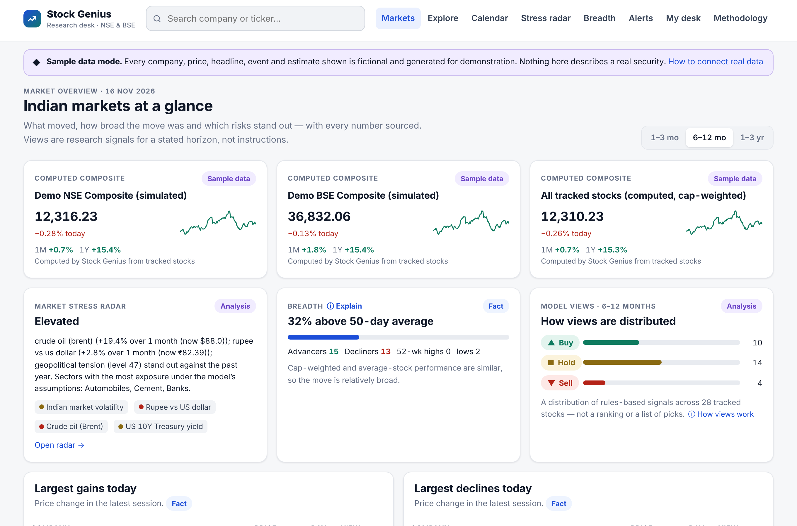
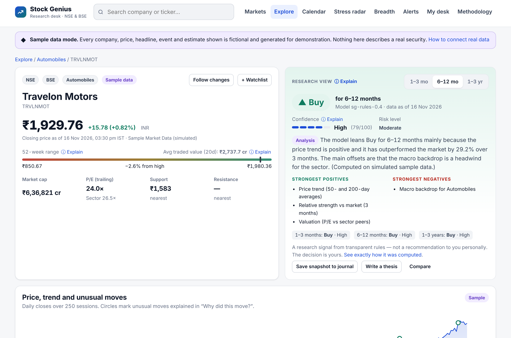
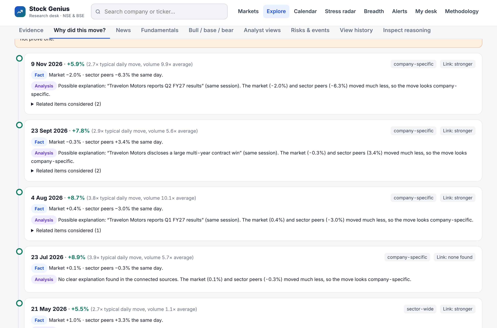
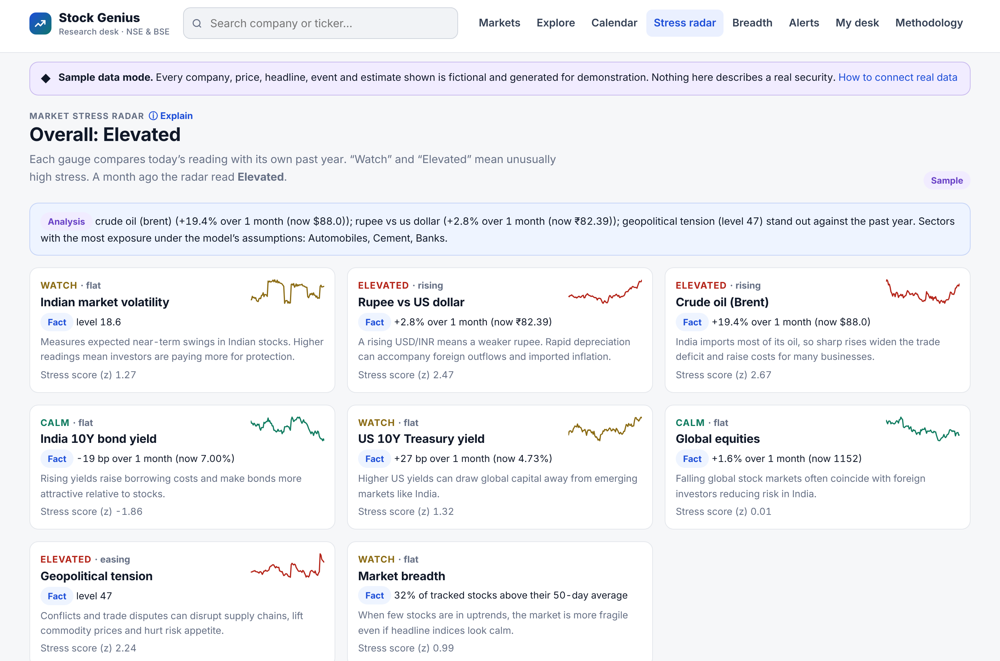
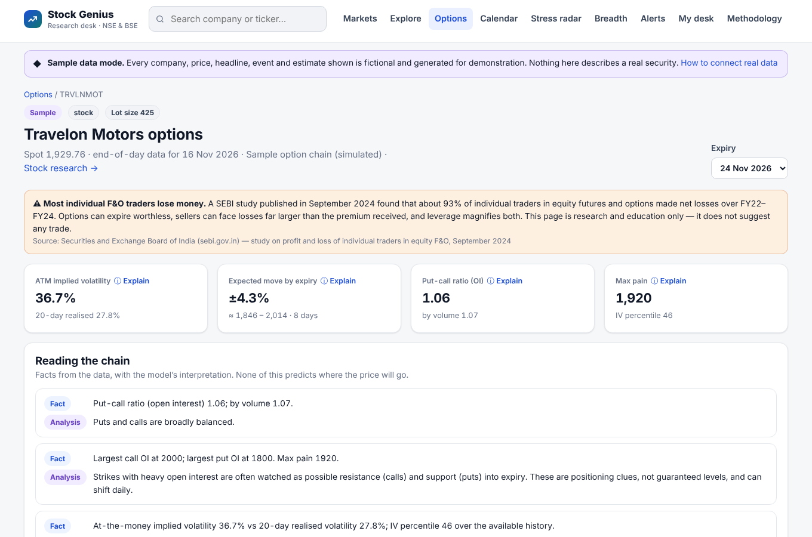
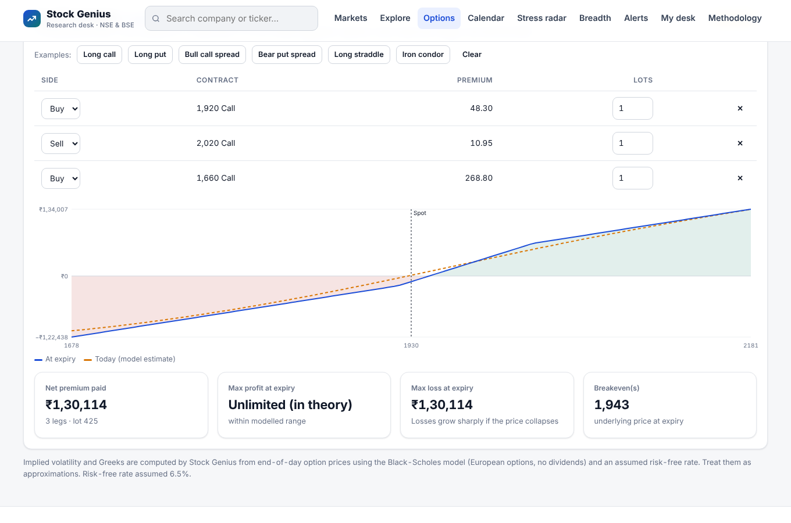

# Stock Genius

A free, ad-supported research desk for stocks listed on India’s **NSE and BSE**. For each stock it gives a transparent **Buy / Hold / Sell research view for a stated time horizon**, the evidence behind it (facts kept separate from model analysis), confidence, risks, catalysts, and what would change the view.

> **Research information only — not investment advice.** Views are generated by published rules, can be wrong, and do not consider any individual’s circumstances. The site does not execute trades or ask for brokerage credentials. All decisions stay with the user. See [docs/COMPLIANCE.md](docs/COMPLIANCE.md) before any public launch.

## Screenshots (sample data)

| Markets overview | Stock research view |
|---|---|
|  |  |
| **Why did this move?** | **Market stress radar** |
|  |  |
| **Options research** | **Payoff simulator** |
|  |  |

## Features

| Area | What it does |
|---|---|
| **Markets overview** | NSE/BSE indices, stress radar summary, breadth, distribution of model views (not a ranking), largest movers, sector returns, market news |
| **Stock research page** | Price chart with 50/200-day averages, support/resistance and unusual-move markers; view per horizon with confidence and risk; evidence by category (Fact vs Analysis, source + timestamp, “what could change it”); news with reported facts, impact analysis and observed reaction; fundamentals and peers; risks, upcoming events and invalidation conditions; full reasoning breakdown |
| **Why did this move?** | Detects unusual daily moves, classifies them as market-wide, sector-wide (vs peers) or company-specific, and lines them up with news, filings and results. Labelled as *possible* explanations |
| **Options research** | For indices and F&O stocks: option chain with computed IV and Greeks, open interest by strike, put-call ratio, max pain, volatility smile, term structure, ATM IV history and percentile, expected move by expiry, and a payoff simulator with example strategies. Research and education only — prominent F&O risk warning, no trade suggestions, no order placement |
| **Catalyst calendar** | Results, dividends, corporate actions and macro/policy events, with the stocks you follow that may be affected directly or via their sector |
| **Signal-change alerts** | Follow a stock to see changes to its view, confidence band, risk level and key signals, each with before/after evidence |
| **Market stress radar** | Volatility, rupee, crude, Indian and US yields, global equities, geopolitical tension and breadth versus their past year, mapped to exposed sectors |
| **Breadth map** | Sector heat map, participation (% above 50/200-day), advancers/decliners and concentration (is the move driven by two names?) |
| **Bull / base / bear** | Assumptions, signposts and volatility-based illustrative ranges (explicitly not targets) |
| **Analyst disagreement** | Range, dispersion and reasons for disagreement when estimates are available; never invents a consensus |
| **My desk** | Watchlists, compare (up to 4), portfolio exposure lens, thesis tracker with auto-checked assumptions, research journal with then-vs-now snapshots |
| **Explain this to me** | Beginner / intermediate / advanced explanations for 30+ terms |
| **View history** | Point-in-time view history plus an audit log of every view the server displayed |
| **Ads** | Consent-gated Google AdSense slots, labelled and kept outside all research content; `/ads.txt` |

## Quick start

Requires **Node.js 20+**. There are no npm dependencies.

```bash
git clone https://github.com/estiquontechnologies/Stock-genius.git
cd Stock-genius
cp .env.example .env
npm start            # http://127.0.0.1:3000 — sample (fictional) data
npm test             # 24 tests
```

### Real data, collected automatically (free sources)

Set in `.env`:

```bash
DATA_PROVIDER=auto
FRED_API_KEY=your_free_key        # optional but recommended (macro gauges)
UPSTOX_ACCESS_TOKEN=              # optional: live last-traded prices from your Upstox account
NEWS_RSS_FEEDS=https://…,https://…  # optional extra news feeds
```

Then run `npm start` and leave it running. The server:

1. Downloads the **Nifty 500 constituents list** (symbols, ISINs, industries), weekly.
2. Downloads ~15 months of **daily candles from the Upstox API** for each stock and for Nifty 50, Nifty 500, SENSEX and India VIX. If Upstox fails for most instruments, it **automatically falls back to the NSE/BSE daily bhavcopy files and the NSE index-close file**.
3. Repeats every day at `COLLECT_TIME_IST` (default 19:15 IST), fetching only what is missing.
4. Downloads the **NSE F&O bhavcopy** (end-of-day option prices and open interest) for recent sessions, keeping full chains for the last 5 sessions and a daily ATM-IV / PCR history.
5. Loads macro series from **FRED** and headlines from the **NSE announcements RSS** and any feeds you add.

The first backfill takes roughly 10–60 minutes. The site shows a “collecting data” state until each stock has ~220 sessions of history. Data is stored under `data/market/`.

## Data: what is real, delayed or simulated

| Mode | Prices | Fundamentals / estimates / corporate calendar | News | Macro |
|---|---|---|---|---|
| `sample` | **Simulated**, fictional companies, labelled everywhere (incl. option chains) | Simulated | Simulated, links to an explanation page | Simulated |
| `auto` | **Real, end-of-day** (Upstox candles or exchange files; options from the NSE F&O bhavcopy). “Live” only for last-traded prices if `UPSTOX_ACCESS_TOKEN` is set | **Not available from free sources** → shown as missing; confidence is reduced | Real RSS headlines, tone not classified | Real (FRED, India VIX) |

Every price shows a freshness badge (Sample / End-of-day / Live) and timestamp. A stale-data banner appears when sessions are missing. Test it with `SAMPLE_FORCE_STALE=true`.

**Version 2 (paid feeds):** licensed real-time/delayed prices for public display, fundamentals, analyst estimates and corporate-action calendars. Add a provider in `server/providers/` that implements the same methods as `AutoEodProvider` and register it in `server/providers/index.js`. Keys go in `.env`, never in client code.

## Stack and why

- **Node.js (built-in `http`, no frameworks or dependencies)**: easy to audit, nothing to patch, one command to run. The server keeps all keys, collects data, computes analysis and serves a JSON API.
- **Vanilla JavaScript ES modules + hand-built SVG charts**: no build step, fast, accessible, with a strict Content-Security-Policy.
- **JSON-file store** for user data (single-user MVP). Use a database with authentication before multi-user/public launch.

```
server/
  index.js, api.js          HTTP server, security headers, routes
  collector/                Daily automated collection (Upstox, NSE/BSE files)
  providers/                sample | auto (+ free/fred.js, free/rss.js)
  analysis/                 indicators, signals, recommend (scoring), moves,
                            stress, breadth, scenarios, portfolio, sectors
  services/                 universe, research orchestration, store, thesis
  content/glossary.js       “Explain this to me” texts
public/                     index.html, css/, js/ (app shell + views)
test/                       node:test suites
docs/COMPLIANCE.md          Regulatory checklist for professional review
```

## How views are computed (summary)

Signals (technical, fundamental, valuation, news, macro, estimates) each produce a score in [−1, 1] with an evidence grade. Category averages are combined with horizon-specific weights; ≥ +0.16 → Buy, ≤ −0.16 → Sell, else Hold. Confidence (10–85, never certain) reflects score strength, signal agreement, missing data, risk and upcoming results. Full details are on the in-app **Methodology** page and in `server/analysis/recommend.js`.

## Advertising

Set `AD_PROVIDER=adsense`, `ADSENSE_CLIENT=ca-pub-…`, slot IDs and `ADS_TXT`. Ads load only after the visitor chooses in the consent banner (“Essential only” requests non-personalised ads). Slots are labelled and never placed inside views, evidence, risks or news. Consider blocking broker, trading-app, “tips” and listed-company ad categories in AdSense to limit conflicts of interest.

## Before going public

Read **[docs/COMPLIANCE.md](docs/COMPLIANCE.md)**. In short: SEBI Research Analyst registration is very likely needed for publishing Buy/Hold/Sell views to the public (free + ads still counts), data licences are needed for public display of exchange data, and DPDP Act obligations apply to user data. A disclaimer alone does not make the product compliant.
